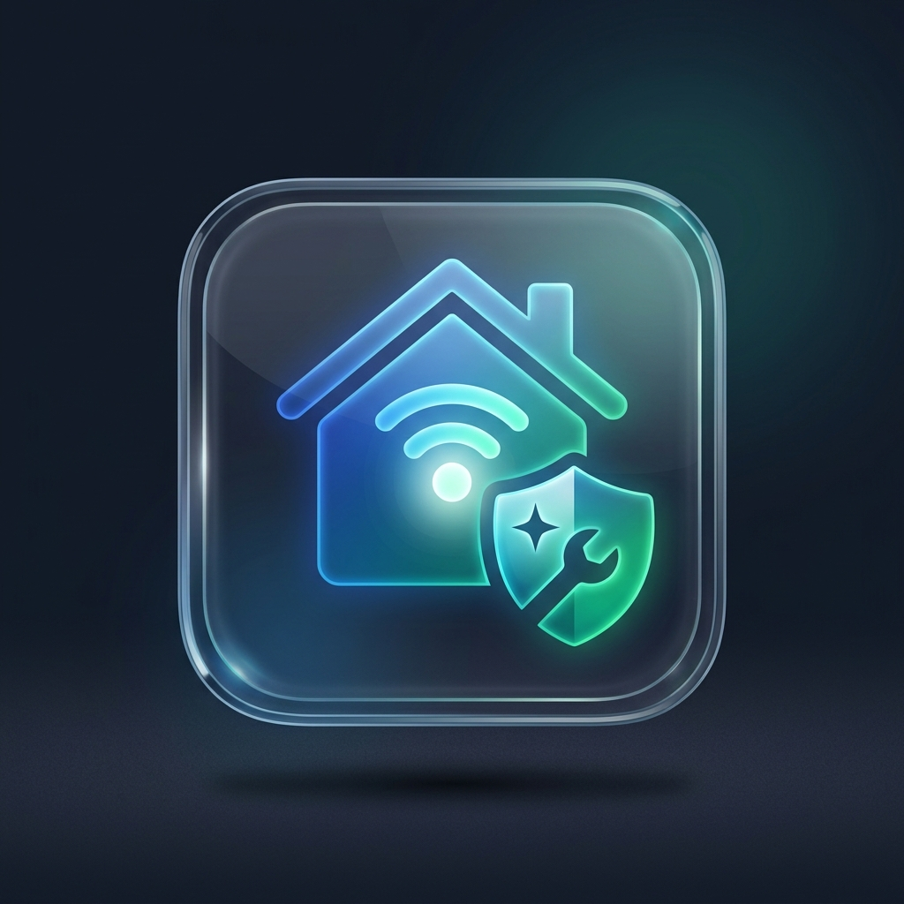
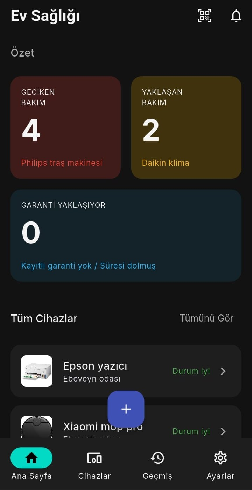
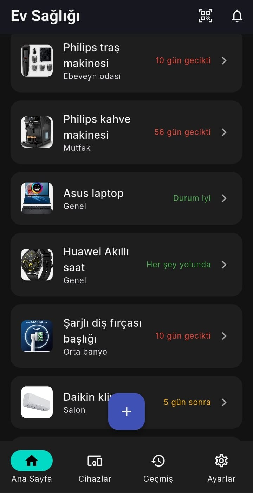
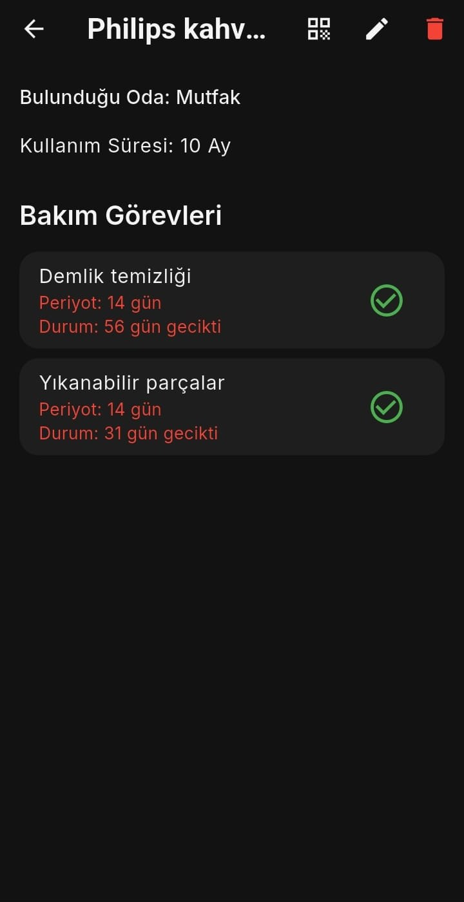
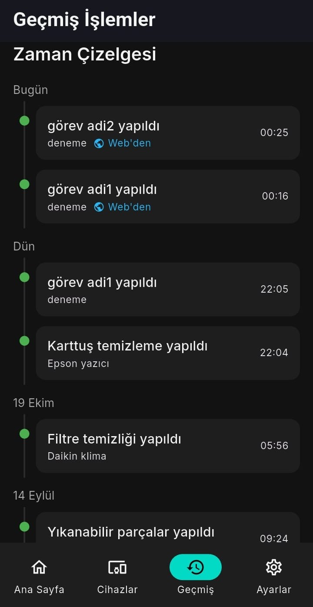

<div align="center">
  
  

  # 🏠 Ev Sağlığı (Homecare)

  **Akıllı Ev Aletleri ve Cihaz Bakım Takip Uygulaması**

  [](#)
  [](#)
  [](#)
  [](#)

  [Özellikler](#-özellikler) • [Nasıl Çalışır?](#-nasıl-çalışır) • [Kurulum](#-kurulum) • [Katkıda Bulunma](#-katkıda-bulunma)

</div>

---

## 🌟 Hakkında

**Ev Sağlığı (Homecare)**, evinizdeki beyaz eşyaların, klimaların, su arıtma cihazlarının ve diğer elektronik aletlerin bakım sürelerini takip etmenizi sağlayan modern bir mobil uygulamadır.

Filtre değişimlerini unutmaya, cihazların kireçlenmesine veya garanti sürelerini kaçırmaya son! Cihazınızın üzerine yapıştırdığınız **karekodu (QR) okutarak** bakımı saniyeler içinde kaydedebilir, bir sonraki bakım için hatırlatıcıyı uygulamaya bırakabilirsiniz. Uygulaması olmayan biri bile karekodu telefonunun kamerasıyla okutup bakım kaydı bırakabilir.

## ✨ Özellikler

*   📱 **Cihaz Yönetimi:** Cihazlarınızı odaya ve kategoriye (mutfak aletleri, ısıtma & soğutma, filtre & arıtma, temizlik, elektronik, kişisel bakım) göre düzenleyin; fotoğraf, satın alma tarihi, garanti süresi, servis bilgisi ve not ekleyin. Cihazlarda arama yapın, bakım durumuna ve kategoriye göre süzün.
*   🔗 **Karekodla Tek Dokunuşsuz Bakım Kaydı:** Her cihaza özel karekodu yazdırın (tek cihaz ya da hepsi tek A4 sayfasında) veya paylaşın. Uygulamanın tarayıcısıyla okutunca bakım **soru sorulmadan** kaydedilir; cihazın birden fazla görevi varsa hangisini yaptığınızı seçersiniz. Yanlışlıkla okuttuysanız **Geri Al**.
*   🌐 **Uygulaması Olmayan Telefonlardan Kayıt (opsiyonel):** Karekodu telefonun kamerasıyla okutan kişi cihaz sayfasında görevi seçip bakım kaydı bırakır; kayıt, uygulamayı açtığınızda Geçmiş'e “Web'den” işaretiyle eklenir. [Kurulum](#-webden-bakım-kaydı-opsiyonel)
*   🔔 **Hatırlatıcılar:** Bakım tarihinden kaç gün önce haber verileceğini (varsayılan 3 gün) ayarlayın, bildirimleri açıp kapatın.
*   📊 **Özet ve Zaman Çizelgesi:** Ana sayfada geciken ve yaklaşan bakımları, garantisi bitmek üzere olan cihazları görün. Geçmiş ekranında yapılan bakımlar güne göre gruplanır, yaklaşan bakımlar üstte listelenir.
*   🛡️ **Çevrimdışı Çalışma (Offline-First):** Verileriniz telefonunuzda saklanır; cihaz yönetimi, karekodla kayıt, geçmiş ve bildirimler internetsiz çalışır. Verileri JSON olarak dışa/içe aktarabilirsiniz. Yalnızca web'den kayıt eşitlemesi ve A4 karekod yazdırma internet ister.
*   🌙 **Karanlık Tema (Dark Mode):** Göz yormayan, şık kullanıcı arayüzü.

## 🚀 Nasıl Çalışır?

1.  **Ekle:** Cihazınızı ve bakım görevlerini (örn. “Filtre değişimi”, her 90 günde bir) ekleyin.
2.  **Yazdır:** Cihaz sayfasındaki karekod simgesine basıp **Yazdır**'ı seçin (ya da Ayarlar'dan tüm karekodları tek A4'e yazdırın).
3.  **Yapıştır:** Çıktıyı cihazın uygun bir yerine yapıştırın.
4.  **Okut ve Kaydet:** Bakımı yaptıktan sonra ana sayfadaki tarayıcı simgesine basıp karekodu okutun. Bakım otomatik kaydedilir, sıradaki tarihi uygulama sizin için takip eder. Çok görevli cihazlarda hangi bakımı yaptığınızı seçersiniz.

## 🌐 Web'den Bakım Kaydı (Opsiyonel)

Karekodu **Homecare yüklü olmayan** bir telefon (aile üyesi, temizlikçi, servis) kamerasıyla okutursa cihaz sayfası açılır: cihaz bilgisi, bakım görevleri ve **Bakımı Kaydet** düğmesi. Kayıt, sizin Google hesabınızdaki bir Sheet'te bekler ve uygulamayı açtığınızda telefonunuza eklenir. Ayrı bir sunucu gerekmez.

*   Kurulum yaklaşık 10 dakika sürer ve ücretsizdir: [`backend/apps-script/README.md`](backend/apps-script/README.md)
*   Her karekodda yalnızca o cihaza özel bir anahtar bulunur; bir karekod diğer cihazlara erişim vermez.
*   Kurulmazsa uygulama bu özellik olmadan da tam çalışır.

## 📸 Ekran Görüntüleri

| Ana Sayfa | Cihazlar | Cihaz Detayı | Geçmiş |
| :---: | :---: | :---: | :---: |
|  |  |  |  |

> **Geçmiş** ekranındaki 🌐 **Web'den** işareti, Homecare yüklü olmayan bir telefondan karekod aracılığıyla bırakılan bakım kaydını gösterir.

## 🛠️ Teknik Detaylar

*   **Framework:** Flutter (Dart SDK ^3.12)
*   **Yerel Veritabanı:** Isar
*   **Durum Yönetimi:** Riverpod
*   **Yönlendirme:** go_router (karekod ve derin bağlantılar dahil)
*   **Karekod:** `mobile_scanner` (okuma), `qr_flutter` ve `pdf` / `printing` (üretme ve yazdırma)
*   **Bildirimler:** `flutter_local_notifications`
*   **Web'den kayıt (opsiyonel):** Google Apps Script + Google Sheets ve GitHub Pages'te yayınlanan cihaz sayfası (`docs/`)

## 💻 Kurulum

Gereksinimler: [Flutter SDK](https://docs.flutter.dev/get-started/install) ve bir Android cihaz ya da emülatör. Uygulama Android'de geliştirilip denenmiştir; iOS için gerekli izin ve bağlantı ayarları eklenmiştir ancak test edilmemiştir.

1. Depoyu klonlayın:
   ```bash
   git clone https://github.com/ovarthy-bot/homecare.git
   ```
2. Proje dizinine gidin:
   ```bash
   cd homecare
   ```
3. Gerekli paketleri indirin:
   ```bash
   flutter pub get
   ```
4. Uygulamayı çalıştırın:
   ```bash
   flutter run
   ```

### Testler

```bash
flutter test
```

Gerçek Isar veritabanıyla çalışan entegrasyon testleri yalnızca Windows'ta çalışır, diğer platformlarda atlanır. Web'den kayıt betiğinin testleri için Node.js (20 veya üstü) gerekir:

```bash
node --test backend/apps-script/Code.test.js
```

### Model değişikliği

Isar kodu (`*.g.dart`) depoda bulunur. `lib/data/models/` altındaki bir modeli değiştirirseniz yeniden üretin:

```bash
dart run build_runner build --delete-conflicting-outputs
```

## 🤝 Katkıda Bulunma

Bu proje açık kaynaktır ve her türlü katkıya (Pull Request, Bug Report, Feature Request) açıktır. Katkıda bulunmak isterseniz lütfen önce bir "Issue" açarak fikrinizi belirtin.

1. Bu depoyu forklayın.
2. Yeni bir dal (branch) oluşturun: `git checkout -b ozellik/YeniHarikaOzellik`
3. Değişikliklerinizi commit edin: `git commit -m 'Yeni harika özellik eklendi'`
4. Dalınıza push yapın: `git push origin ozellik/YeniHarikaOzellik`
5. Bir Pull Request oluşturun.

## 📝 Lisans

Bu proje **MIT Lisansı** ile lisanslanmıştır. Daha fazla bilgi için [LICENSE](LICENSE) dosyasına göz atabilirsiniz. Telif hakkı © 2026 OnurSuperAI.

---
*Evinizin sağlığı bizim için önemli! 💙 Destek olmak isterseniz projeye ⭐ (Yıldız) vermeyi unutmayın.*